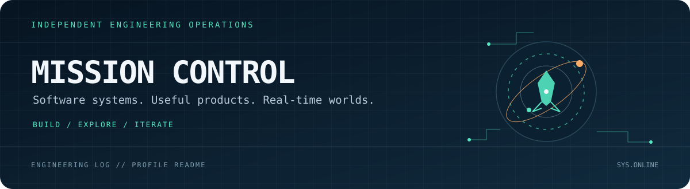

<p align="center">
  
</p>

<p align="center">
  <strong>SOFTWARE ENGINEERING · PRODUCT BUILDING · REAL-TIME 3D</strong>
</p>

<p align="center">
  I build useful software, explore ambitious ideas, and turn technical curiosity into working products.
  <br />
  From backend architecture and full-stack applications to simulation and 3D worlds.
</p>

<p align="center">
  <a href="https://github.com/shadow3312?tab=repositories">
    
  </a>
  <a href="mailto:eludeceti@gmail.com"></a>
  <a href="https://www.linkedin.com/in/euloge-amour"></a>
  <a href="https://shuruzer.app"></a>
</p>

---

<p align="center">
  
</p>

---

## `01 / MISSION BRIEF`

```text
CALLSIGN      SOFTWARE ENGINEER
OPERATING MODE  BUILD · TEST · LEARN · SHIP
PRIMARY SYSTEMS FULL-STACK / BACKEND / PRODUCT ENGINEERING
SIDE MISSIONS  REAL-TIME 3D / SIMULATION / SYSTEMS EXPLORATION
```

I care about the craft behind the interface: clear architecture, maintainable code, thoughtful developer experience, and products that solve real problems. I also like stepping outside the usual web stack to explore 3D environments, simulation, and lower-level systems.

## `02 / ACTIVE MISSIONS`

<table>
  <tr>
    <td width="50%" valign="top">
      <h3>◈ Product engineering</h3>
      <p>Designing and building useful products from domain model to user experience: workflows, APIs, persistence, validation, and polished interfaces.</p>
      
    </td>
    <td width="50%" valign="top">
      <h3>◈ Systems & architecture</h3>
      <p>Exploring dependable backend foundations, clean boundaries, authentication, authorization, and pragmatic architecture that can evolve with a product.</p>
      
    </td>
  </tr>
  <tr>
    <td width="50%" valign="top">
      <h3>◈ 3D & simulation</h3>
      <p>Building interactive worlds and experimenting with rendering, performance, scene composition, and the engineering challenges behind real-time 3D.</p>
      
    </td>
    <td width="50%" valign="top">
      <h3>◈ Flight Deck Lab</h3>
      <p>A playground for aviation-inspired interfaces, spatial interaction, and simulation ideas. A place to turn visual experiments into technical prototypes.</p>
      <sub>STATUS · EXPERIMENTAL</sub>
    </td>
  </tr>
</table>

## `03 / TECH SYSTEMS`

<p align="center">
  
</p>

<sub>These badges represent technologies in my learning and building orbit. Remove any that don't reflect your current experience.</sub>

## `04 / RECENT TRANSMISSIONS`

<!-- RECENT_REPOS_START -->
_The mission log is waiting for its first scheduled update.
<!-- RECENT_REPOS_END -->

## `05 / ENGINEERING PRINCIPLES`

- **Build for change:** keep boundaries clear and make future decisions reversible where possible.
- **Prefer useful complexity:** reach for advanced tools when they solve a real problem, not just because they are interesting.
- **Measure before optimizing:** especially in rendering, database access, and application performance.
- **Ship the experiment:** a small working prototype teaches more than an endless design document.

---

<p align="center">
  
</p>

<p align="center">
  <sub>TRANSMISSION END · ALWAYS EXPLORING WHAT'S NEXT</sub>
</p>
